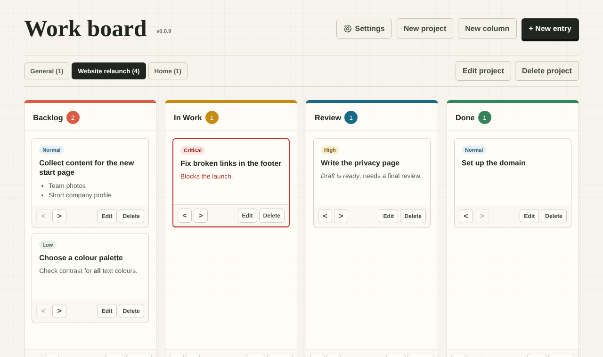

# Work board

A personal Kanban board that runs entirely in your browser. No server, no account, no tracking. Open `board.html` and start working; your data never leaves your browser.

The interface is available in English and German (German name: *Arbeitsboard*).



## Features

### Board

- **Projects:** separate boards for different topics, shown as tabs. The project *General* always exists.
- **Columns:** create, rename, recolour, reorder and delete. Entries in a deleted column move to the neighbouring column. Every column can also be cleared: after one confirmation, all its entries are deleted.
- **Done columns:** mark any column as done. The tab of each project shows how many open entries it has.
- **Entries:** title, formatted description and one of four priorities (low, normal, high, critical). Critical entries get a red frame.
- **Due dates:** entries due today or tomorrow are highlighted, overdue entries are marked in red. Entries in a done column are no longer highlighted.
- **Entry types:** task (default), story, bug and idea. Each type has its own icon and label, while priorities use colour, so type and priority are never confused.
- **Drag and drop** to move entries between and within columns, plus buttons to move them one column left or right.
- **Read view:** a click on an entry's title shows the whole entry, with a button to edit it. The rest of the card stays free for dragging, so a drag never opens anything. Long descriptions fade out on the card.
- **Sorting:** show the entries of all columns in your own order (drag and drop), by due date or by priority. Sorting only changes the view; your own order is kept. Each project remembers its choice.
- **Touch screens:** on tablets and phones, press and hold an entry for a moment, then drag it with your finger. The page scrolls along at the top and bottom edge. A short swipe still scrolls as usual.
- **Quick add:** every column has a **+** button that creates an entry directly in that column.
- **Move entries between projects and columns** from the edit dialog.
- **Search** in titles and descriptions. Several words narrow the result; press <kbd>/</kbd> to jump to the search field, and clear it with the **✕** in the field or <kbd>Esc</kbd>.
- **Filter by type and priority:** show all entries, a single type or priority, or any combination, for example only critical bugs. The priority buttons carry the colours of the priority labels. A **Due** button shows only entries that are overdue or due today or tomorrow; its number turns red as soon as something is overdue. *All* resets type, priority and due filter. Search and filter work together. Each project keeps its own search and filter, and both are remembered for the next visit. The filter bar always says how many entries are shown, and while a filter is active the column counters read "shown / total".

### Description editor

- Bold, italic, bulleted lists and two text colours.
- Keyboard shortcuts: <kbd>Ctrl</kbd>+<kbd>B</kbd> for bold, <kbd>Ctrl</kbd>+<kbd>I</kbd> for italic and <kbd>Ctrl</kbd>+<kbd>Z</kbd> to undo the last formatting step. On a Mac, use <kbd>Cmd</kbd> instead of <kbd>Ctrl</kbd>.
- Pasted or dropped content is inserted as plain text, so no foreign formatting or code ends up in an entry.
- Built on the standard Selection and Range APIs, without the deprecated `document.execCommand()`.

### Your data

- **Stored locally** in the browser (`localStorage`). Nothing is sent anywhere.
- **Export and import** the whole board as a JSON file under *Settings*. Before an import replaces the board, the current state is backed up in the browser.
- **Self-repairing storage:** if stored data is damaged, only the broken entries are corrected or skipped. The original data is kept as a backup and can be downloaded.
- **Several tabs at once:** open tabs stay in sync. If two tabs change the board at the same moment, the second change is rejected instead of silently overwriting the first.
- **Clear error messages** when the browser storage is full or blocked. The board stays usable in that case.

### Settings

- Board name: your own name for the board, shown at the top and in the browser tab in every language. Leave it empty to use the default name.
- Language: English (default) or German.
- Appearance: light (default), dark, or following the operating system.
- Export and import of the board.
- The version number of the app.

### Security

- Strict Content Security Policy: only the app's own scripts and styles may run, no external requests.
- Descriptions pass an allowlist sanitizer: only the formatting the editor offers survives, every other element and attribute is removed.
- No runtime dependencies and no build step.

### Accessibility

- Almost everything works with the keyboard: entries open with <kbd>Enter</kbd> on their title, move to another column with the arrow buttons, and project tabs support the arrow keys, <kbd>Home</kbd> and <kbd>End</kbd>. Changing the order within a column needs a mouse or a finger.
- <kbd>Esc</kbd> closes every dialog.
- Buttons and regions have accessible labels; reduced motion settings are respected.

## Getting started

1. Download or clone this repository.
2. Open `board.html` in your browser. A double-click is enough; no web server is needed.

You can also put the files on any static web host. Note that each browser and each address (for example `file://` versus `https://`) has its own storage, so a board created in one place does not appear in another. Use export and import to move it.

### Back up your board

The board lives only in the browser you use. Clearing your browser data deletes it. Export it regularly under *Settings*.

### Browser support

Current versions of Chrome, Edge, Firefox and Safari (Chrome and Edge 98 or later, Firefox 94 or later, Safari 15.4 or later). The automated tests run in Chromium.

## Development

The app is plain HTML, CSS and JavaScript without a build step. The scripts are loaded as classic scripts, so the board also works when opened directly from disk.

| Path | Content |
| --- | --- |
| `board.html` | Page structure and dialogs |
| `styles.css` | All styles |
| `js/i18n.js` | English and German texts |
| `js/sanitize.js` | Allowlist sanitizer for descriptions |
| `js/model.js` | Data model, validation and repair of stored data |
| `js/storage.js` | Reading and writing `localStorage`, backups, conflict detection |
| `js/editor.js` | Formatting in the description editor |
| `js/app.js` | User interface and event handling |
| `tests/unit.html` | Module tests that run in any browser |
| `tests/board.spec.mjs` | Browser tests with Playwright |

### Running the tests

Module tests: open `tests/unit.html` in a browser. No installation needed.

All tests, including the module tests, with [Playwright](https://playwright.dev) and Node.js:

```sh
npm install
npx playwright install chromium
npm test
```

## License

[MIT](LICENSE). Copyright (c) 2026 Aaron Kreis, [aaron.de](https://aaron.de).

You may use, change and share this project freely, as long as the copyright notice and the license text stay with it.
